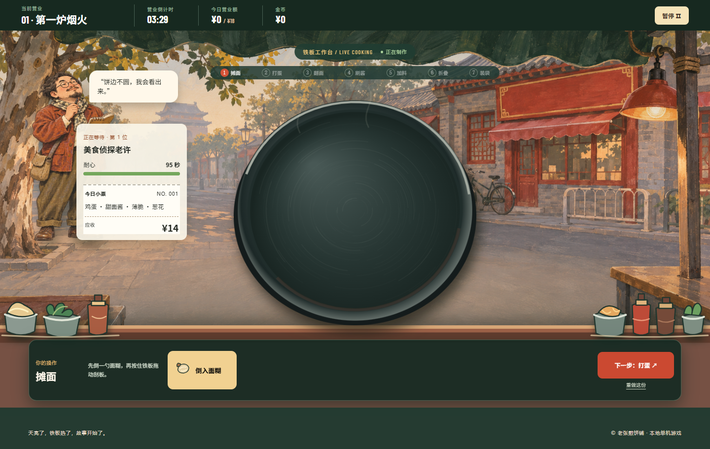

# 煎饼果子模拟器 · Jianbing Simulator

一款可以直接在浏览器里玩的中文街头早餐摊游戏。React + TypeScript + Vite；V2 使用手绘场景与人物素材、SVG 工具和随操作轨迹绘制的 Canvas 食物。无需账号、后端、付费接口或外部游戏服务。

**在线游玩：** [https://yanlvlab.github.io/jianbing-simulator/](https://yanlvlab.github.io/jianbing-simulator/)



美术规范与组件映射见 [V2 美术规范](docs/V2_ART_DIRECTION.md)，动画逐项测试与画面记录见 [V2 验收记录](docs/V2_ANIMATION_TEST.md)。

虚拟玩家完整试玩、真实摊制视频与同类游戏的对照及后续缺口见 [试玩对照记录](docs/BOT_PLAYTEST_AND_REFERENCES.md)。

针对玩家截图的后续修订与 1440×900、火候、蘸酱、撒料、折叠、切断装袋的验收截图见 [V3 玩家反馈记录](docs/V3_PLAYER_FEEDBACK.md)。
针对虚拟玩家发现的手机同屏、步骤提示和火候节奏问题，以及新版台面与食材截图，见 [V4 试玩修订记录](docs/V4_PLAYTEST_FIXES.md)。
鸡蛋、撒料、折叠遮盖、纸袋成品、按钮交餐的最新修订与独立 AI 试玩见 [V5 食物流程与试玩记录](docs/V5_FOOD_FLOW_AND_BOT_AUDIT.md)。

## 本地运行

需要 Node.js 20 或更高版本。进入本目录后运行：

```bash
npm ci
npm run dev
```

打开终端显示的本地地址。正式构建：

```bash
npm run build
npm run preview
```

`dist/` 是可部署的静态文件。Vite 使用相对路径 `base: './'`，可放在 GitHub Pages 的仓库子路径下。

## 玩法

1. **摊面**：自由模式可先选原味、杂粮或紫米面糊。点「倒入面糊」，按住铁板用鼠标或手指画圈。覆盖越完整、形状越圆，评分越高。
2. **打蛋**：点鸡蛋，再在饼面按住拖动涂匀。双蛋订单需要点两次。
3. **翻面**：铁板从摊面开始预热；观察火候进度条，在绿色区间点「现在翻面」。太早夹生，太晚烧焦。
4. **刷酱**：点右侧搪瓷缸蘸酱，再在饼面按住拖动；刷子会逐渐变淡，需要时再蘸。多酱订单要蘸刷多次。
5. **加料**：点右侧簸箕抓料，在饼上按住拖动撒开。多加要求再抓一把。
6. **折叠**：点击「折左边」「折右边」，两侧面饼会收拢并盖住食材。
7. **切断装袋**：沿煎饼中线从左向右划过，再从饼中央拖向右侧纸袋；完成后点击顾客头顶的成品图像交餐。自由模式点击试吃。评分综合面饼、蛋液、火候、订单准确度、折叠和速度。

主线共 10 关，完成营业额目标解锁下一关。无尽模式累计三位流失顾客时结束；自由制作模式不限时。金币可在商店购买铁板、刮板和出餐升级，以及新食材和装饰。

## 存档

存档自动写入当前浏览器的 `localStorage`，含关卡、星级、金币、食材、升级、无尽纪录、音效、音乐、成就和当前对局。刷新进行中的对局后会暂停，点击继续即可。设置页可导出和导入 JSON；重置存档须经过两次确认。损坏的存档会恢复到默认状态。不同设备不会自动同步，请用 JSON 文件转移。

## 项目结构

```text
src/
  assets/        手绘街景和五位顾客画页
  components/    铁板 Canvas、食材与工具 SVG、场景道具
  data/          关卡、顾客、食材和订单配置
  game/          制作状态、覆盖度、评分和星级
  systems/       版本化存档、Web Audio 音效
  App.tsx        游戏流程与界面
  styles.css     基础样式
  styles-v2.css  V2 场景、HUD、手机布局与动画
tests/           浏览器实际操作脚本
docs/            V2 美术规范、动画测试记录和截图
.github/workflows/deploy.yml
```

## GitHub Pages 发布

当前独立仓库已启用 GitHub Pages。推送至 `main` 后，`deploy.yml` 会执行 `npm ci`、`npm run build`，并发布 `dist/`。复制到其他独立仓库时，在 **Settings → Pages → Build and deployment** 中选择 **GitHub Actions**。如需在多项目仓库中发布，请把工作流移到仓库根目录的 `.github/workflows/`，并给构建和上传路径加上项目目录前缀。

## 验收

| 检查项                       | 状态与证据                                                        |
| ---------------------------- | ----------------------------------------------------------------- |
| 启动、构建                   | `npm run dev` 启动；`npm run build` 通过                          |
| 一份煎饼完整流程             | `tests/playthrough.mjs` 浏览器实测到出餐评分                      |
| 真实拖动摊面、涂蛋与按钮折叠 | 浏览器鼠标路径和折叠按钮实测；移动端触控命中实测                  |
| 火候影响评分                 | 评分函数按翻面火候计算；实测在绿色区间翻面                        |
| 订单与错误配料影响满意度     | 小票要求与实际用量逐项比较，禁忌香菜额外扣分                      |
| 关卡结算、星级、解锁         | `tests/level-and-mobile.mjs` 完成第一关两单、出现星级并解锁第二关 |
| 十关配置                     | `tests/levels-smoke.mjs` 逐关进入并验证顾客订单                   |
| 金币累计、消费、升级         | 通关获得金币；`tests/save-and-endless.mjs` 实测消费并刷新保留     |
| 无尽模式结束与纪录           | 同上，实测三位顾客流失后结算并保存最高纪录                        |
| 自由制作                     | `tests/playthrough.mjs` 实测自由搭配与评价                        |
| 刷新、导出导入、损坏恢复     | `tests/save-and-endless.mjs` 实测                                 |
| PC 与手机                    | 1440px 鼠标与 390px 触控浏览器实测                                |

浏览器脚本使用 Playwright 和本机 Chrome，执行前先运行开发服务器，然后分别运行：

```bash
node tests/playthrough.mjs
node tests/level-and-mobile.mjs
node tests/save-and-endless.mjs
node tests/levels-smoke.mjs
node tests/visual-v2.mjs
node tests/v5-mobile-flow.mjs
```

`playthrough.mjs` 可通过 `TEST_BASE_URL` 指向已部署网址；已对 GitHub Pages 版本执行完整出餐测试。

脚本里的 Chrome 路径目前为 Windows 默认安装路径；其他系统可修改 `executablePath`。截图输出会保存到 `tests/` 且被 Git 忽略。
