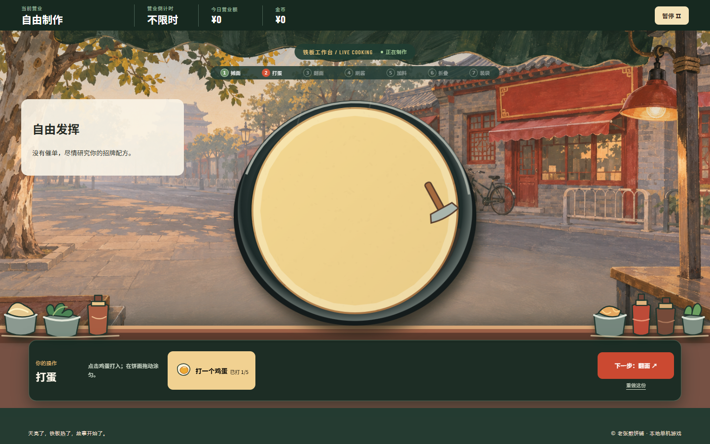
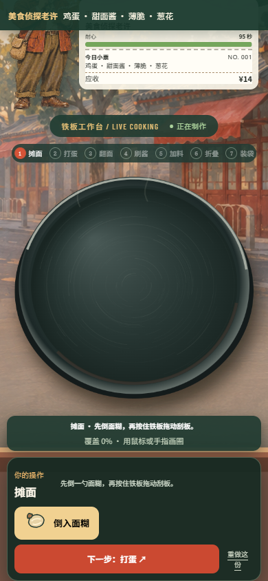

# 虚拟玩家试玩与参考对照

日期：2026-11-18。测试环境：Chrome、1440×900 鼠标、390×844 触屏模拟。虚拟玩家通过 Playwright 逐步点击、拖动画圈、涂蛋、翻面、刷酱、加料、折叠、装袋，完成自由模式一份成品（98 分），再完成第一关并验证星级、金币和解锁。浏览器截图保存在 `tests/`；可复现脚本为 `tests/playthrough.mjs`、`tests/level-and-mobile.mjs` 和 `tests/visual-v2.mjs`。

## 对照与改动

| 参考观察                                                                                                                                                                                                              | 试玩中看到的问题                                                                         | 本轮修改与复测                                                                                                                                  |
| --------------------------------------------------------------------------------------------------------------------------------------------------------------------------------------------------------------------- | ---------------------------------------------------------------------------------------- | ----------------------------------------------------------------------------------------------------------------------------------------------- |
| [How视频：正宗天津煎饼果子](https://www.youtube.com/watch?v=1YfDyUQH19E) 的步骤说明包括倒面糊、刮圆、打蛋并摊开、起边翻面、刷酱。                                                                                     | 涂蛋后蛋黄仍以完整圆形停在中央；重复绘制点导致蛋液出现规则圆斑。                         | 随真实拖动点列形成连续蛋液，蛋黄随涂抹消散，去掉逐点圆斑。见下方涂蛋截图。                                                                      |
| [煎饼果子制作视频](https://www.youtube.com/watch?v=vGhs115_vcg) 的步骤说明强调翻面后的酱料与薄脆、最后卷折。                                                                                                          | 出餐步骤本身可完成；操作顺序与常见视频大体吻合，但葱花目前只能在翻面后加入。             | 保留现有七步制作与评分规则；葱花加入时机仍是待改进的真实流程差异。                                                                              |
| [《可口的披萨》开发者资料](https://goodpizzagreatpizza.com/press/)强调顾客订单、厨房制作、满意反馈的连贯操作；[官方商店页](https://store.steampowered.com/app/770810/Good_Pizza_Great_Pizza/)展示配料触感和设备升级。 | 手机滚到铁板和工具栏时，顾客小票离开视野，玩家需要反复向上查单；配料按钮只显示已加数量。 | 加入随页面滚动保持可见的订单速览；按钮显示「已加/目标」，需要、完成、禁忌有不同状态。脚本曾抓到外层裁切使悬停失效，修复后在工具栏位置实测可见。 |

## 结果和边界

- `npm run build` 通过。完整出餐 98 分，第一关结算、金币与解锁、手机触控通过。
- 参考视频网页提供步骤说明；当前环境未逐帧分析其视频画面，因此上述对照限于可核查的步骤与本游戏截图，不声称完成精确动作捕捉。
- 角色手臂仍为单姿势素材，葱花加入时机与常见摊制过程存在差异；这两项需要分层素材或流程调整，未用装饰动画冒充完成。
