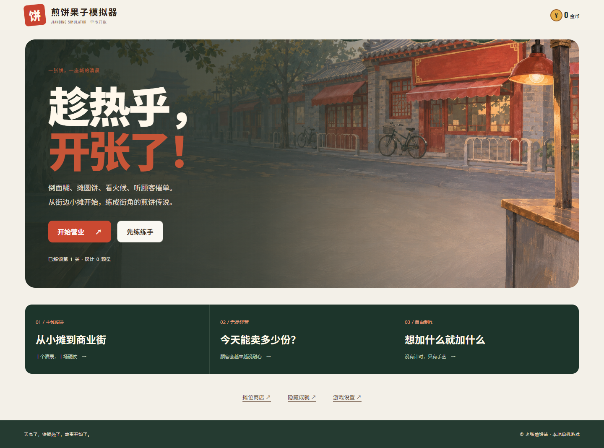
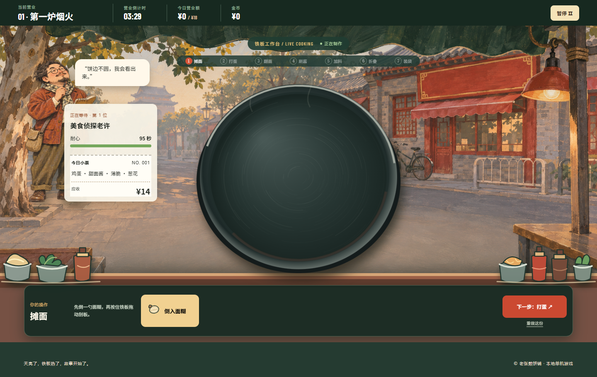
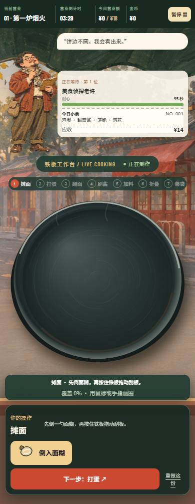
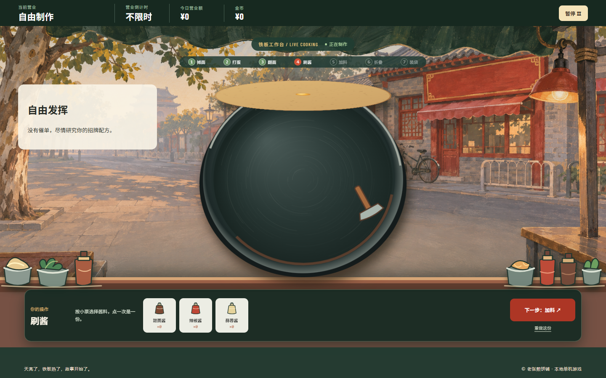
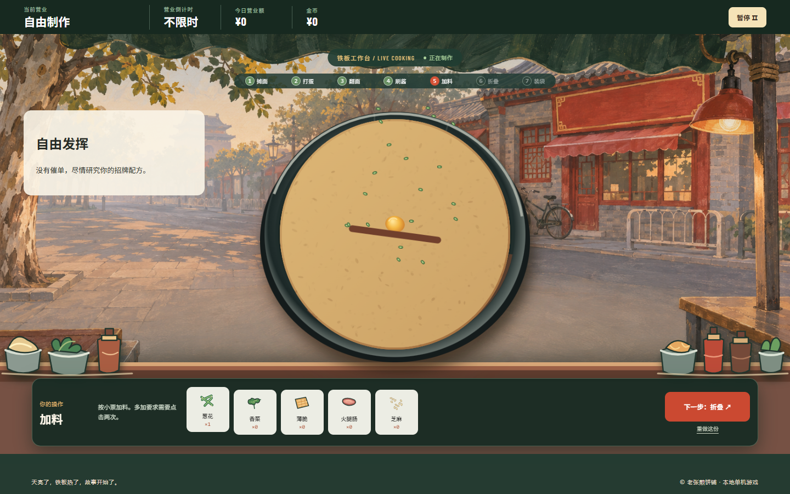
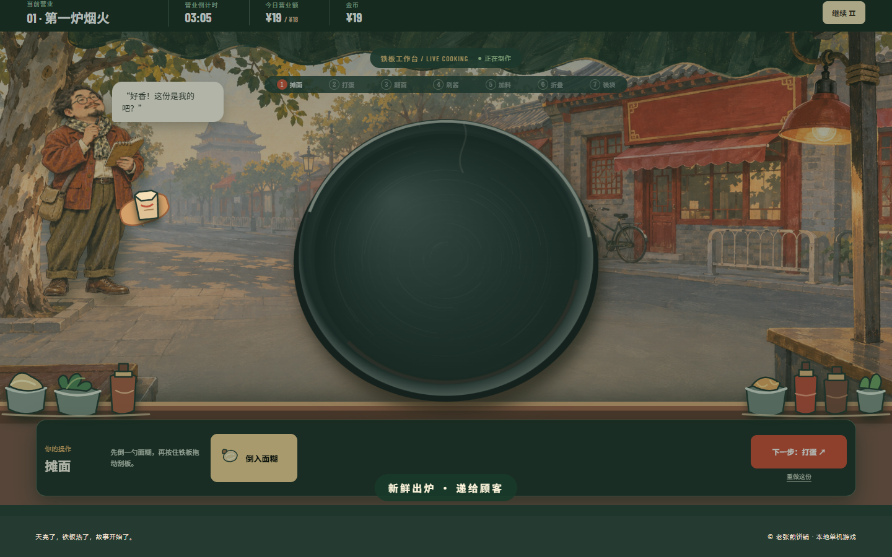

# V2 动画与回归测试记录

测试日期：2026-11-18。浏览器：本机 Chrome，桌面 1440×900、触屏模拟 390×844。

| 动作         | 状态绑定与检查结果                                                                         |
| ------------ | ------------------------------------------------------------------------------------------ |
| 倒面糊、摊面 | 倒入时液流扩散；拖动点列形成连续轮廓，覆盖率来自同一轨迹。鼠标与触屏已实测。               |
| 打蛋         | 点击触发蛋壳落下，蛋白绘制跟随实际涂抹点列。                                               |
| 翻面         | 火候值仍参与评分；点击后饼与蛋液共同抬起、收缩、翻落，翻铲进入画面。                       |
| 刷酱         | 选择酱料后可在饼上拖动刷子，酱料沿实际轨迹出现；仅点击时也会播放与该次添加绑定的刷酱笔迹。 |
| 加料         | 点击对应食材后，新增食材从上方落入，旋转与缩放后停在饼面。                                 |
| 折叠         | 从左右饼边向中心拖动，左右饼层分别展开并盖住部分配料。                                     |
| 装袋         | 点击后面饼进入纸袋，纸袋折合并向顾客方向移动，之后显示评价。                               |
| 顾客         | 入场说话、待机、临界耐心抖动、离开、满意或失望反馈有不同过渡。                             |

`tests/playthrough.mjs` 执行了七步完整出餐，并保存中间帧到 `tests/v2-anim-*.png`。翻面阶段的 500 毫秒采样记录 31 帧，中位帧间隔 16.7 毫秒；这是该设备上的一次测量，不代表所有设备持续稳定 60 FPS。面饼和蛋液图层复用缓存，减少翻面动画中的重复纹理绘制。

回归测试：`tests/level-and-mobile.mjs` 完成第一关、结算、金币与解锁；`tests/levels-smoke.mjs` 验证十关入口与订单；`tests/save-and-endless.mjs` 验证导出导入、商店消费、损坏恢复、对局恢复和无尽结算。`npm run build` 通过。减少动态效果已加入设置与存档，并对 CSS 动画及 Canvas 过渡生效。

## 画面证据

## 剩余美术缺口

角色目前是同一画页上的单姿势角色，情绪由场景运动表现；逐帧口型、独立手臂接餐仍需分层角色素材。场景前景的食材容器与酱料瓶为手绘 SVG，笔触密度低于生成的街景与角色。现有素材已统一色彩和描边，但这两处还有继续打磨空间。
