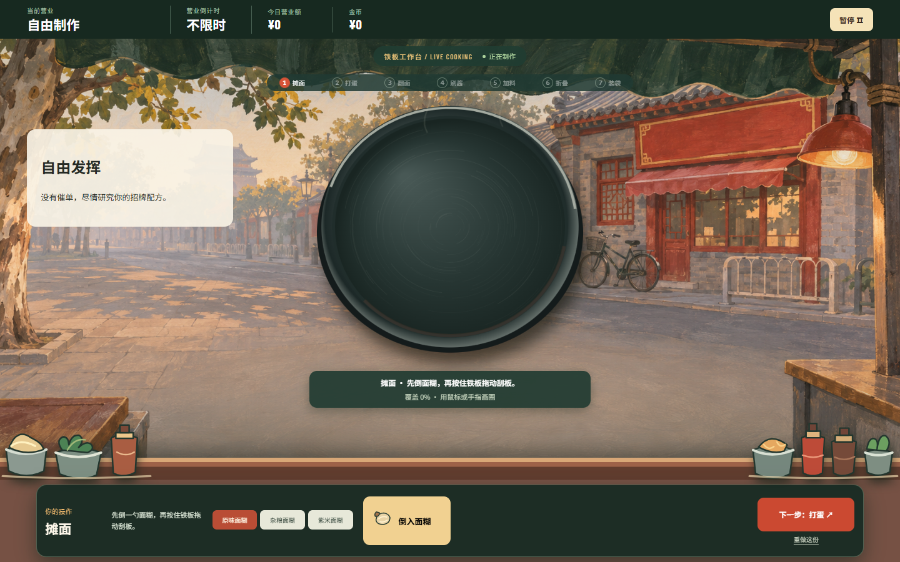
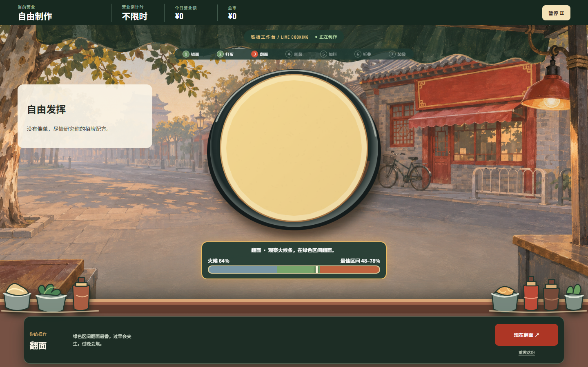
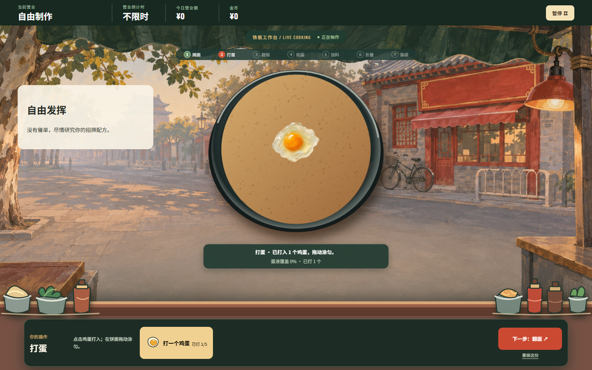
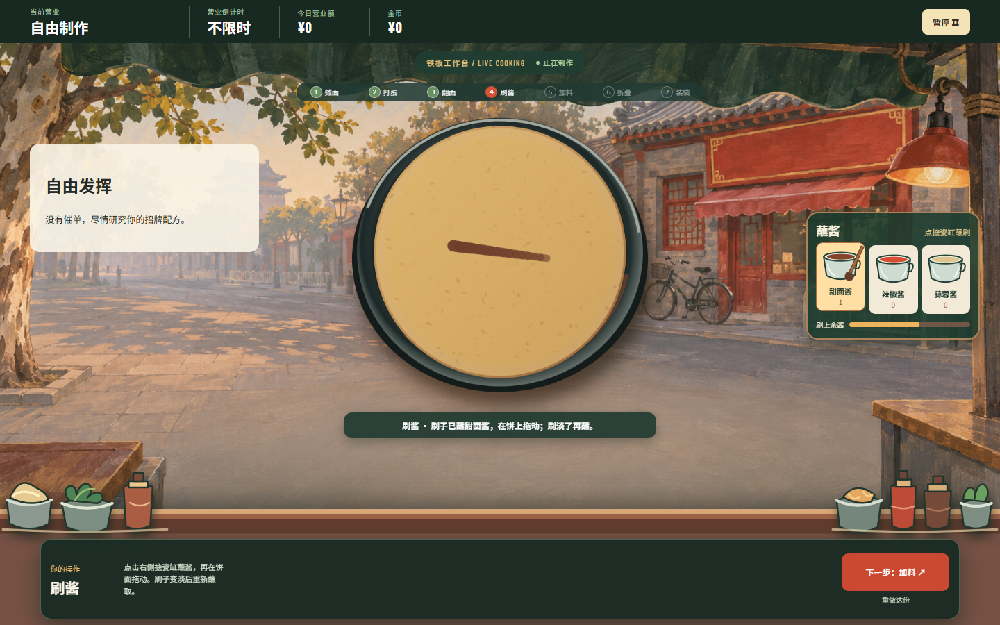
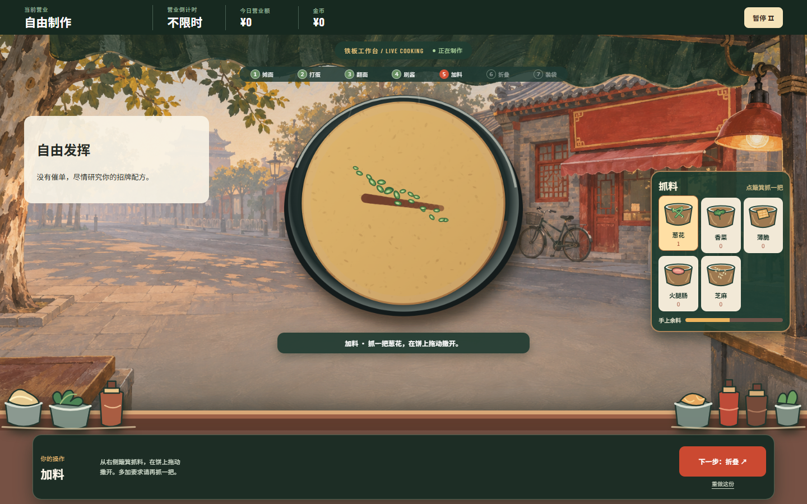
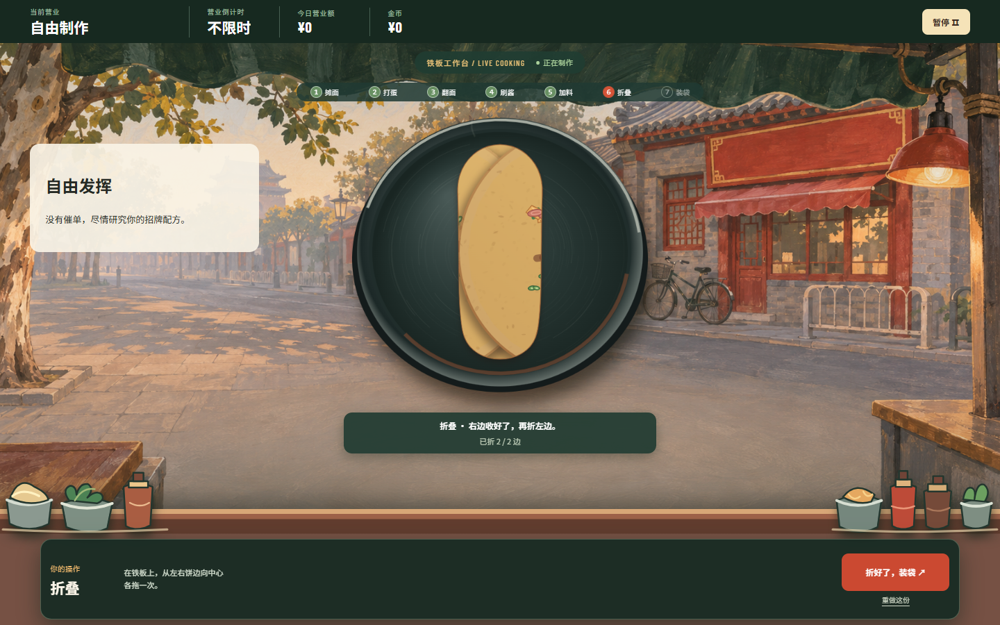
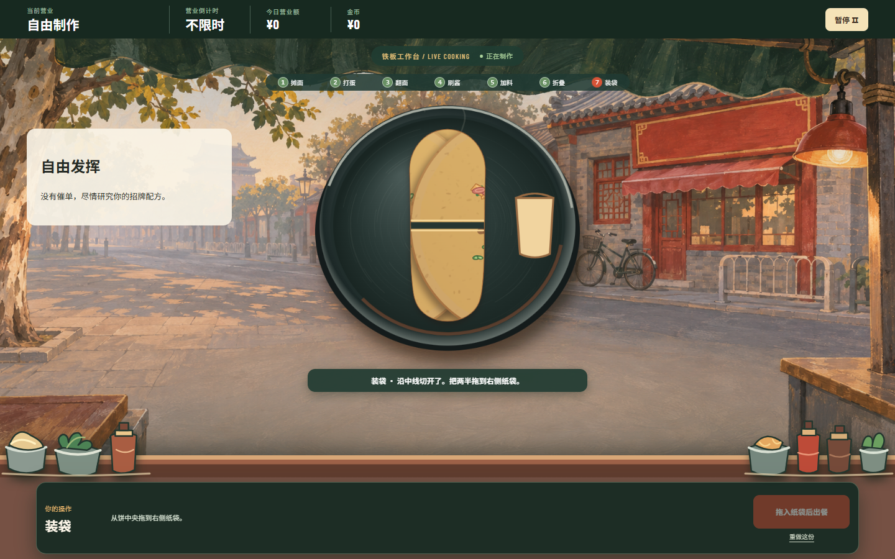
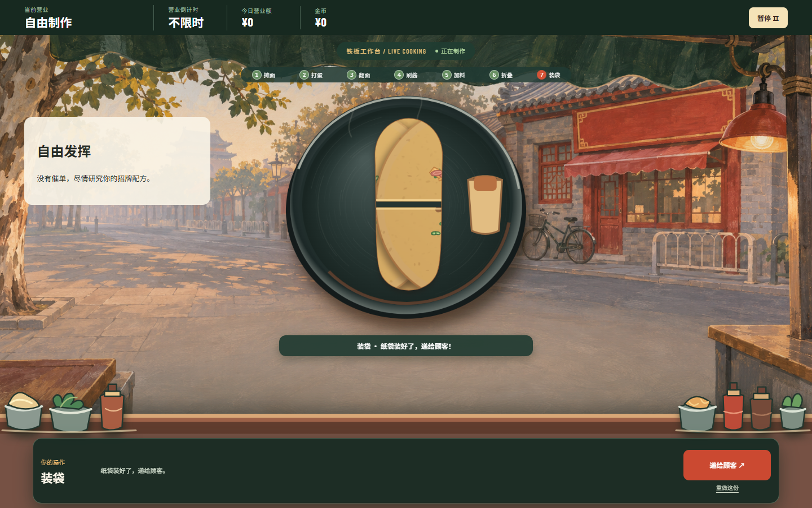

# 玩家反馈修订与虚拟玩家验收

日期：2026-11-19。依据玩家提供的五张 1440×900 截图修订。虚拟玩家用 Playwright 操作真实按钮和 Canvas，走完摊面、打蛋、翻面、蘸酱刷酱、抓料撒料、双侧折叠、划断、拖入纸袋、递给顾客的流程。脚本：`tests/playthrough.mjs`、`tests/level-and-mobile.mjs`、`tests/viewport-audit.mjs`。

| 玩家指出的问题     | 修改与实测                                                                                        |
| ------------------ | ------------------------------------------------------------------------------------------------- |
| 锅被遮挡           | 桌面游戏固定在一屏内；1440×900 实测锅底 593px、工具栏顶 776px，提示条也不被遮住，页面无纵向滚动。 |
| 火候看不见         | 绿色最佳区间与实时指针固定在锅下方，虚拟玩家在翻面前检查它仍位于工具栏上方。                      |
| 打蛋僵硬           | 增加独立蛋液纹理素材、蛋壳分开落下与蛋白落点扩散；涂抹仍沿玩家轨迹，并逐渐抹散蛋黄。              |
| 酱料靠下方点击     | 场景右侧搪瓷缸可点击蘸刷，刷子负载随拖动下降，颜色和宽度随之变淡，再次点缸可重新蘸取。            |
| 配料瞬移且形状扁平 | 场景簸箕选择配料，拖动时在实际轨迹附近逐粒撒下，最新粒子从上方落到饼面。                          |
| 折叠后饼没收拢     | 面饼两侧消失于锅面，原有饼纹和食材层翻到中央，最终形成窄长的双层形状。                            |
| 切断装袋自动完成   | 必须横向划过中线切开，再从中央拖向右侧纸袋，出餐按钮此后才可用。                                  |

## 制作与竞品参考

[How视频的煎饼果子教学](https://www.youtube.com/watch?v=1YfDyUQH19E)描述了刮圆面糊、打蛋摊开、起边翻面；[另一份制作视频](https://www.youtube.com/watch?v=vGhs115_vcg)描述了翻面、酱料、薄脆和卷折。这里依据网页可读取的步骤说明对照，未对视频逐帧测量。[《可口的披萨》开发者资料](https://goodpizzagreatpizza.com/press/)把顾客订单与厨房动作连成一轮服务；[《烹饪模拟器》官方介绍](https://store.steampowered.com/app/641320/Cooking_Simulator/)强调每次手部动作都对食材产生可见影响。对应地，本轮把操作入口从下方菜单移到场景容器，并让拖动位置决定刷痕与落料分布。

音乐和音效继续由 Web Audio API 合成。本轮增加低音量五声音阶营业旋律、蛋壳与刮板等动作的噪声质感；音乐与音效分别可关闭，设置随本地存档保存。

## 仍需打磨

蛋液为分层素材与 Canvas 涂抹的组合，蛋壳为程序绘制，尚未达到实拍或逐帧手绘的细节。配料的葱花、香菜、薄脆仍以矢量笔触绘制，近看比生成的背景简洁。角色手臂没有独立接餐帧。生成过一版配料画页，但存在明显杂色边缘，因此没有纳入游戏。以上为当前美术缺口，不作为已完成效果宣传。
