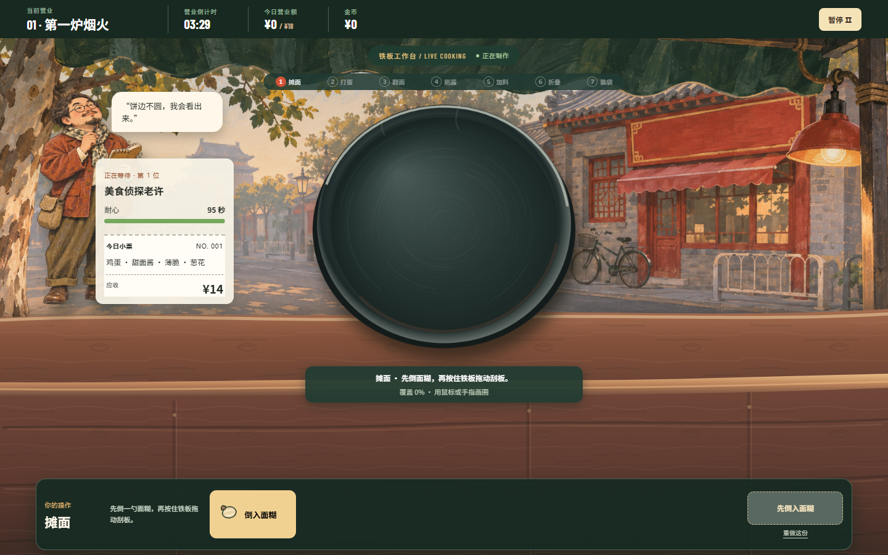
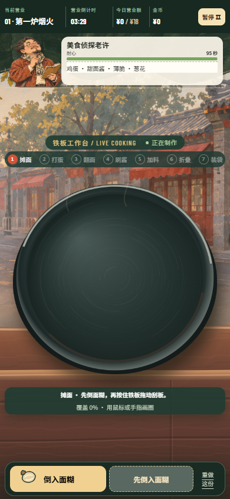
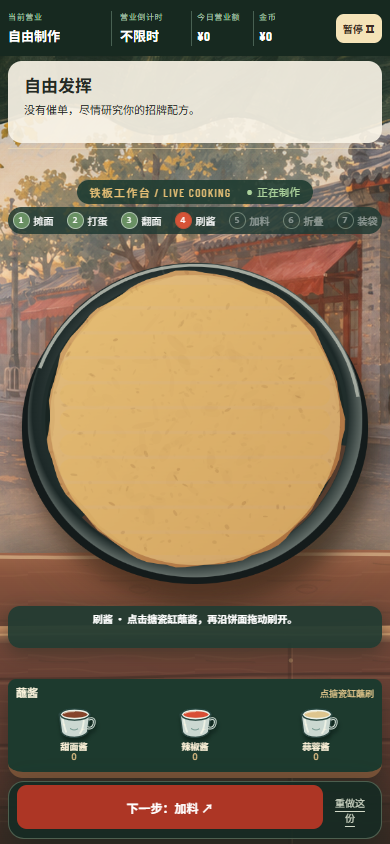
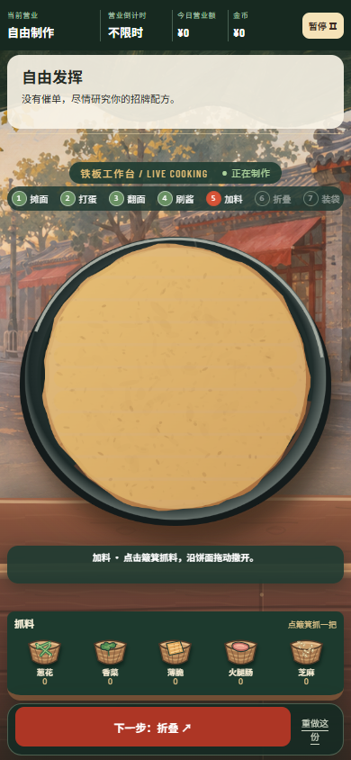
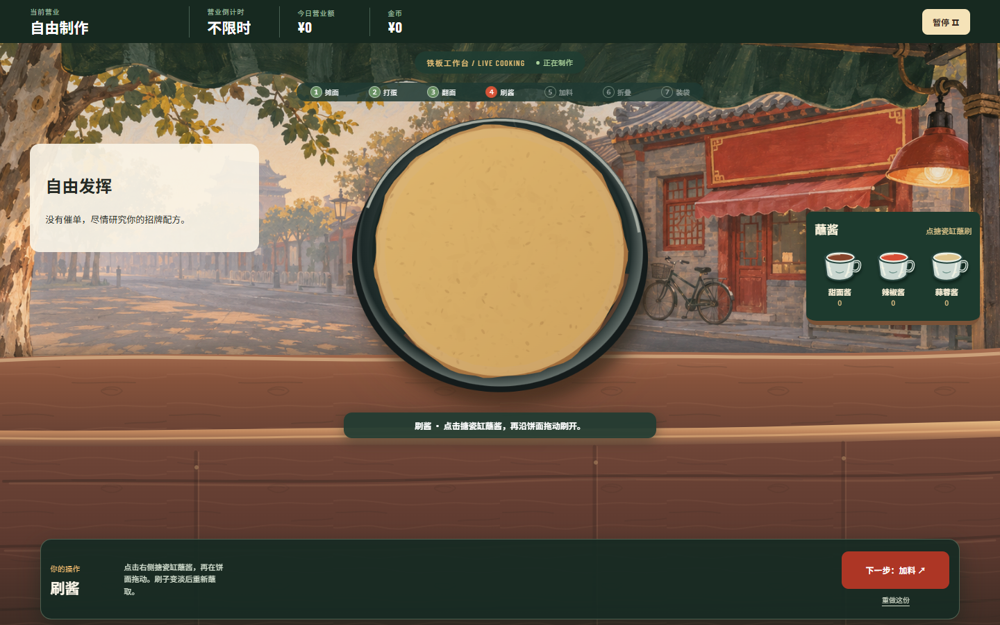

# 虚拟玩家反馈修订

日期：2026-11-20。独立 Playwright 测试代理在 390×844 视口发现手机按钮落到屏幕外、未完成步骤仍可点击「下一步」、翻面阶段从 0 开始空等。本轮保留关卡和评分逻辑，修订界面、火候节奏及场景素材。

| 问题 | 修改 | 实测 |
| --- | --- | --- |
| 手机铁板与工具栏不能同屏 | 顾客缩为半身展示与紧凑小票，铁板按视口高度缩放，当前工具留在底部 | 390×844 下铁板、投料按钮均可见；刷酱和加料阶段，锅底 y603、容器 y679–778、操作按钮 y785–829 |
| 「下一步」误导 | 摊面不足 38%、蛋液不足 28% 或折边不足 2 次时，按钮显示当前进度并禁用 | 浏览器脚本验证倒面糊前无法进入下一步，完成后完整制作可通关 |
| 火候阶段纯等待 | 摊面时开始缓慢预热，翻面前上限 45%；翻面后加热速度提高 | 虚拟玩家等待火候到约 60% 再翻面，自由制作得 97 分 |
| 场景与工具穿帮 | 铁板下加入独立绘制的木质台面；酱缸和配料筐改成两种容器；鼠标工具分别绘制刮板、酱刷、撒料手势和切刀 | 桌面及手机浏览器截图复核，翻面时饼不再越出锅沿 |
| 饼面像平整色块 | 仅对玩家真实摊开的区域加入不规则边缘、焦边和受热斑纹 | 手机刷酱阶段截图复核；覆盖与评分仍取真实拖动轨迹 |

本轮执行 `npm run build`、`tests/playthrough.mjs`、`tests/level-and-mobile.mjs`、`tests/mobile-station-audit.mjs`、`tests/visual-v2.mjs`、`tests/save-and-endless.mjs`，均通过。手机同屏检查同时验证酱料与配料容器不遮挡铁板。

仍未完成逐帧手绘的打蛋和翻面动画、独立角色接餐动作；这些仍是美术质量缺口。本轮主要减少了明显穿帮，不能把它们宣传为实拍级动画。
