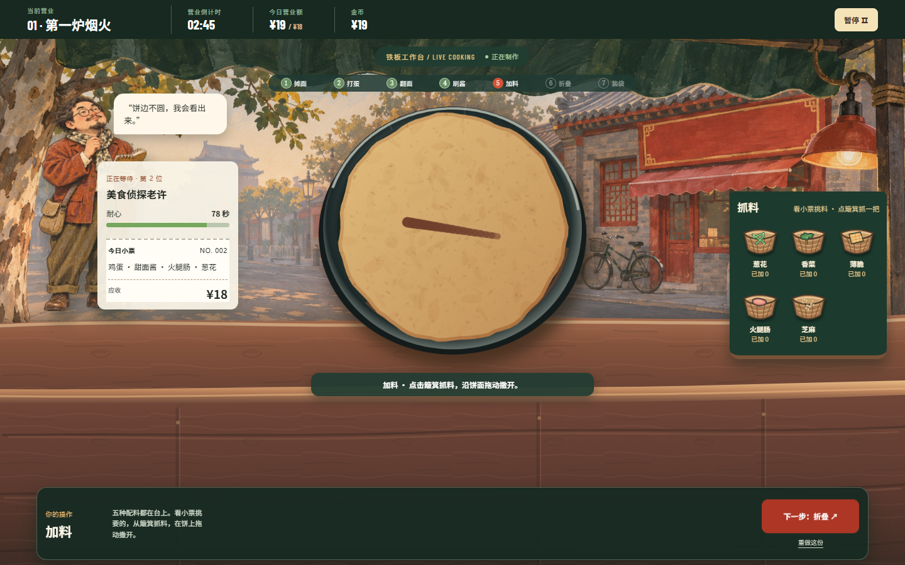
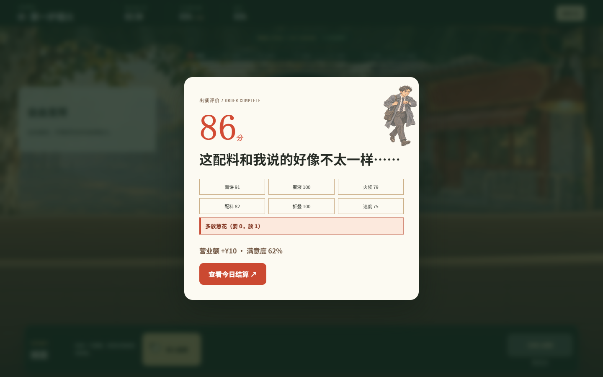

# V6 按单选料与独立试玩

日期：2026-11-20。

## 本轮改动

- 第一关起展示五种配料：葱花、香菜、薄脆、火腿肠、芝麻。普通订单随机从五种中选两种；第四关起通常选三种。甜面酱、辣椒酱也从第一关供玩家选择。需购买的蒜蓉酱始终显示，并标记未解锁。
- 食材容器只显示玩家已加数量，不显示订单目标，也不再用颜色指出正确选项。顾客小票和手机订单速览仍完整写明需求与禁忌。
- 错放、漏放或多放任意一味都会被标记为错单；结算逐项写出“要几份、放了几份”，并降低满意度与收入。自由制作的搭配评分保留原规则。
- 订单生成现在接收已开放食材清单，购买蒜蓉酱后才可能接到相关订单。旧存档与导入存档会补齐现在的基础食材，原有关卡、金币、设备和成就继续保留。

## 独立 bot 试玩与《沙威玛传奇》核查

独立 AI 试玩 bot 在修改前完成本游戏自由制作和第一关两单，确认了原先“固定订单 + 容器显示目标数字”的低难度问题。修改后通过浏览器重新验证随机订单、五种容器同屏、按小票加料、结算与存档。

查找网上《沙威玛传奇》demo 的结果：没有找到可在当前浏览器直接玩的可信官方 demo。[Steam 官方页面](https://store.steampowered.com/app/3036080/)展示正式游戏，未列浏览器试玩入口；[Google Play 官方页面](https://play.google.com/store/apps/details?id=com.company.shaw)是安装版。[EasyFun 云试玩页面](https://www.easyfun.gg/cloud-games/shawarma-legend-cloud-online.html)经浏览器实测返回 HTTP 403；[好游快爆快玩页面](https://m.3839.com/c/158829.htm)要求通过其 App，浏览器访问超时。因此没有声称 bot 玩过《沙威玛传奇》本体。对标仅依据官方公开介绍中的精确订单、定制配料、顾客偏好和设备升级，具体落地为本轮“读小票自主选料、错料有明确后果”。

## 验收

- `tests/order-choice.mjs`：80 次随机首关订单均为五选二，五种配料都能出现；多加一味会标记错单、解释原因并减少收入。
- `tests/level-and-mobile.mjs`：第一单按随机小票制作，第二单故意多放一味并核对错单说明、满意度上限；整关仍可获得星级和金币、解锁第二关；手机触屏可操作。
- `tests/playthrough.mjs`：自由制作完整流程与订单加载。
- `tests/save-and-endless.mjs`：导入导出、商店、刷新恢复、无尽模式纪录。
- `tests/v5-mobile-flow.mjs`：移动端制作、折叠、装袋和交餐。
- `npm run build`：通过。

本轮没有引入新的美术素材，也没有复制《沙威玛传奇》的画面或资源。
