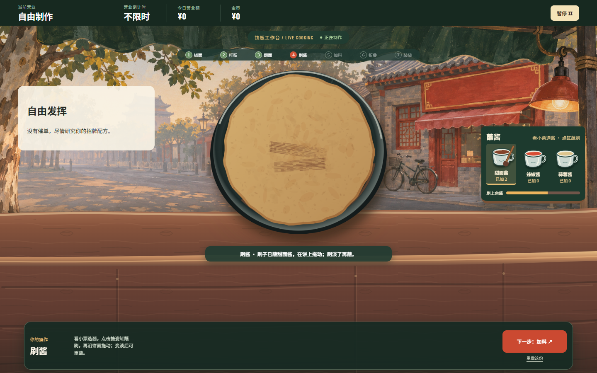
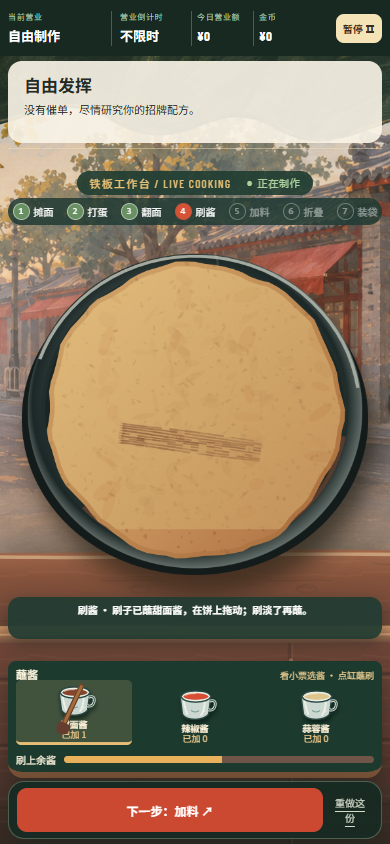

# V7 刷酱动作修订

日期：2026-11-23。

旧画法把玩家的拖动轨迹直接描成一条约 20 像素宽的实线，画面更像抹酱。本轮保留搪瓷缸蘸酱、刷子余量、订单计数和评分流程，重做轨迹的画法：

- 刷头按拖动方向转动；手柄、金属箍和扁平刷毛在铁板上跟随指针。
- 每次落刷会记录起点，抬刷后重新落下不会把两段轨迹误连成一条线。
- 饼面酱迹由九束宽窄略异的刷毛线组成，带少量半透明底色和断续的干刷痕；刷子余量越低，痕迹越淡、空隙越多。重新蘸酱后留下颜色更实的第二笔。
- 酱迹仍从真实拖动点列生成。静止帧缓存按点列引用复用，避免动画帧反复计算完整纹路。

`tests/playthrough.mjs` 实际从倒面糊做到出餐，途中检查第一笔刷至余量不足 40%、再蘸同一缸后计数为两份；`tests/v5-mobile-flow.mjs` 与 `tests/level-and-mobile.mjs` 回归手机和第一关流程；`npm run build` 通过。刷毛和酱迹目前仍为程序绘制的 2D 表现，不是流体仿真。
