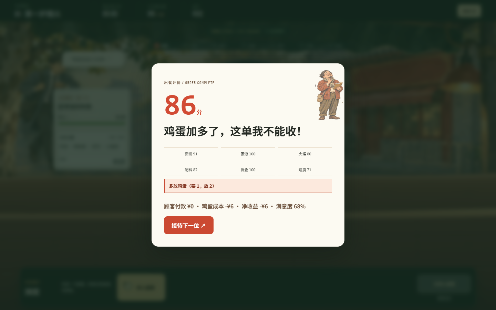

# V8 鸡蛋成本与亏损规则

日期：2026-11-23。鸡蛋每颗按游戏内成本 **¥3** 计算。

- 营业额仍表示顾客付款，用于关卡目标和无尽纪录；金币按本单净收益变化：`顾客付款 − 实际打入鸡蛋数 × ¥3`。
- 订单要求一颗却打了两颗、要求两颗却打了三颗等多蛋错单会被顾客拒收，顾客付款为 ¥0，实际消耗的鸡蛋照扣。因此一颗需求却打两颗时净收益为 **-¥6**；金币余额不足时可以变成负数，存档导出、导入和刷新会保留负余额。
- 正确的双蛋订单正常收款并扣两颗蛋成本。其他配料错误仍按原错单付款规则结算，然后扣实际鸡蛋成本。自由制作是练习，不扣金币。
- 单笔评价展示顾客付款、鸡蛋成本和净收益；关卡结算分别展示营业额、鸡蛋成本、净收益。旧版进行中的存档缺少成本累计字段时安全补齐，不改变既有金币余额。

验证：`tests/order-choice.mjs` 检查单颗成本、额外鸡蛋导致负收益、自由制作不扣金币及负余额存档往返；`tests/level-and-mobile.mjs` 用浏览器实际完成一份多蛋错单，核对顾客付款 ¥0、鸡蛋成本 ¥6、净收益 -¥6、金币减少 ¥6；`tests/playthrough.mjs`、`tests/save-and-endless.mjs` 回归原流程；`npm run build` 通过。
